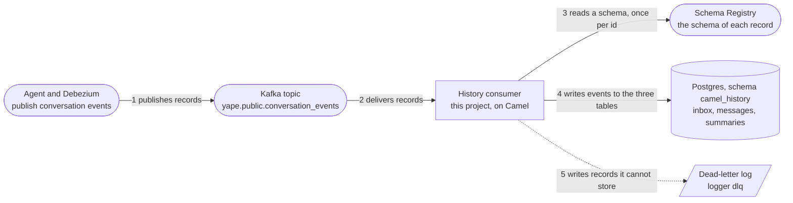
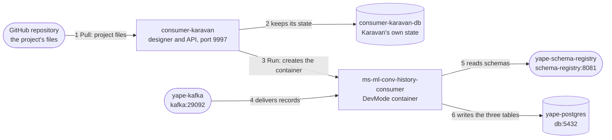
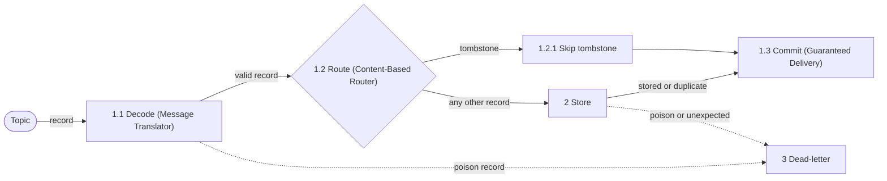
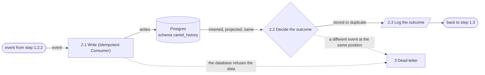
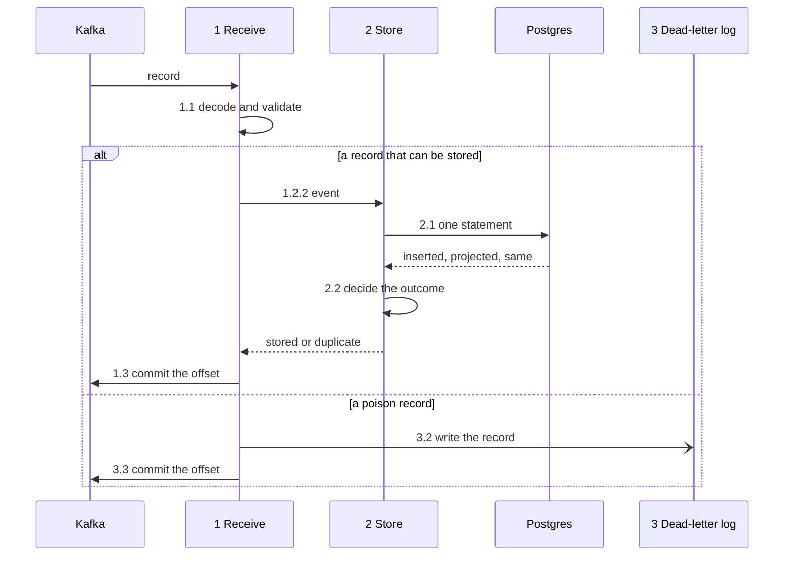

# Design

How the history consumer is built, from the big picture down to the steps. Each diagram shows **one level of detail**,
and the numbers and names are the same in every diagram, in the Karavan Designer and in the logs. Behaviour in words:
[conv-history-consumer.md](conv-history-consumer.md). Running it: [karavan-setup.md](karavan-setup.md).

New here? Read Level 1, then the vocabulary. Debugging? Level 2 and the sequence. Changing it? Level 3 and the reading map.

## Vocabulary

| Word | Means |
|---|---|
| **record** | One Kafka message, as delivered: bytes, with the Schema Registry header. |
| **event** | The conversation fact inside a record (`UserMessageSent`, ...). |
| **tombstone** | A record with an empty value. Skipped. |
| **poison record** | A record that can never be stored: it breaks the schema or the contract, or the database refuses it. |
| **dead-letter log** | Where poison and unexpected records are written: logger `dlq`, `ERROR`, with the body. "DLQ" is only the prefix of its lines. |
| **outcome** | What route 2 decided: `stored`, `duplicate`, or a refused conflict. |

## Legend

| In a diagram | Means |
|---|---|
| Solid arrow / **dashed** arrow | The normal path / a failure path (a record that cannot be stored). |
| Number on an arrow | Reading order. Start at 1. |
| `1`, `2`, `3` before a route; `1.1`, `2.3` before a step | Route *n*; step *m* of route *n*. A third number (`1.2.2`) is a branch. |
| Rectangle, rounded box, diamond | A part we run; a system we use but do not run; a decision. |
| Cylinder, tilted box | A data store; a log. |
| (Parentheses) | The Enterprise Integration Pattern the step implements. |

Nothing is told by color: every meaning is also in a shape, a line style or a label.

---

## Level 1: context

*In words:* the agent and Debezium publish records to a Kafka topic. The consumer reads them, reads each schema from the
registry once, writes the events to three Postgres tables, and writes any record it cannot store to the dead-letter log.
The original service, `ms-ml-conv-history-bs`, reads the same topic as another consumer group and writes the same tables
in the schema `public`: the two never compete.

---

## Level 2: containers

*In words:* Karavan pulls the project from GitHub, keeps its state in its own database, and its **Run** creates the
`ms-ml-conv-history-consumer` container, which reads Kafka and the registry and writes Postgres. All share the network
`yape-local`.

---

## Level 2: the routes

*In words:* route 1 decodes and validates a record (1.1). A tombstone is skipped; any other record goes to route 2 to be
stored. Then the offset is committed (1.3). A record that fails validation, or that route 2 cannot store, goes to route 3
instead (dashed).

| Route | File | Called by |
|---|---|---|
| **1 Receive** | `consume-conversation-events.camel.yaml` | the topic |
| **2 Store** | `store-conversation-history.camel.yaml` | step 1.2.2, as `direct:store` |
| **3 Dead-letter** | `handle-errors-and-dead-letters.camel.yaml` | the error rules, as `direct:deadLetter` |

---

## Level 3: the steps

### Route 2: how one event reaches the three tables

*In words:* step 2.1 writes the event with one SQL statement. Step 2.2 reads what it returned: stored, duplicate, or a
different event already holds that position. A conflict, or data the database refuses, goes to route 3. Otherwise 2.3 logs
the outcome and control returns to 1.3.

### Route 3: a record that cannot be stored

| Step | What | Why |
|---|---|---|
| 3.1 Name the reason if none | An unexpected error gets its exception class (`field=`) and message (`detail=`). | Poison and refused records already have theirs. |
| 3.2 Write the dead-letter log | One `ERROR` line on logger `dlq`: reason, field, topic, partition, offset, key, detail, body. | The record can be found and replayed. |
| 3.3 Commit (Guaranteed Delivery) | The offset moves. | No record blocks a partition. |

---

## The life of a record

*In words:* a valid record is stored through route 2 and its offset committed. A poison record is written to the
dead-letter log and its offset committed all the same. A failure that is **not** the record's fault (database or registry
unreachable) takes neither path: the record is retried in place, and its offset does not move.

---

## Reading map

Reading the Designer? Find the step; the **Docs:** line of its note points to the same place.

| Step | It does | Read more |
|---|---|---|
| Topic | Reads the events topic | [Settings](conv-history-consumer.md#settings) |
| 1.1 Decode | Schema id, registry schema, contract, projection | [Schema assurance](conv-history-consumer.md#schema-assurance), [Projection](conv-history-consumer.md#projection-what-becomes-a-message) |
| 1.2 Route | Skips a tombstone, stores the rest | [What happens to each kind of record](conv-history-consumer.md#what-happens-to-each-kind-of-record) |
| 1.3 Commit | Moves the offset, only now | same |
| 2.1 Write | One statement, one transaction | [The store](conv-history-consumer.md#the-store-one-statement-one-transaction) |
| 2.2 Decide the outcome | stored, duplicate or conflict | [What happens to each kind of record](conv-history-consumer.md#what-happens-to-each-kind-of-record) |
| Error rules (`errorRules`) | Poison, refused, dependency down, unexpected | same |
| 3.1 to 3.3 | Name the reason, write the log, commit | [The dead-letter log](conv-history-consumer.md#the-dead-letter-log) |
| Any pattern name | What the pattern is | [Pattern map](#pattern-map) |

## Pattern map

| Pattern | Where | Camel element |
|---|---|---|
| Event-Driven Consumer | The topic | `from: kafka` |
| Message Translator | 1.1 | `bean` (`decoder`) |
| Content-Based Router | 1.2, 3.1 | `choice` |
| Idempotent Consumer | 2.1: a redelivery writes nothing | `sql` with `ON CONFLICT DO NOTHING` |
| Guaranteed Delivery | 1.3, 3.3: the offset moves after handling | `bean` (`offsetCommit`), `autoCommitEnable=false` |
| Invalid Message Channel | Poison, or data the database refuses | `onException` with `handled`, to `direct:deadLetter` |
| Dead Letter Channel | Every unexpected error, after 3 retries | `errorHandler: deadLetterChannel` |
| Pipeline | The steps of a route | the default of a route |

The idempotency is the database key `(conversation_id, sequence)`, not Camel's `idempotentConsumer`: the original decides
"same event, or a different one at the same position" in SQL, and this keeps the two identical.

## Camel conventions followed

- **One route, one purpose, one level;** routes call each other through `direct:`.
- **An `id` on every route and step, a short `description`, the reason in `note`.** The Designer shows the description as
  the label (cut at 32 characters, then `...`), so it says *what*; the note says *why* and ends with a **Docs:** pointer.
- **Canonical YAML DSL**, not the compact shorthand (Camel warns: `YAML DSL compact notation detected`).
- **Configuration outside the routes**, overridable from the environment: `{{app.topic}}`, `APP_TOPIC`.
- **Error handling apart from the routes**, in a named `routeConfiguration` (`errorRules`) that each route references.
- **A Dead Letter Channel for the unexpected, specific `onException` rules for the known.** An `onException` inherits the
  handler's retries unless it sets its own, so the poison rules set `maximumRedeliveries: 0` (the tests caught this).
- **Small beans where YAML would be unclear**, each registered with `@BindToRegistry`.
- **Commit after handling, never before:** manual commit, at-least-once, an idempotent store.
- **A dedicated logger for the dead-letter log**, and health and metrics on.
