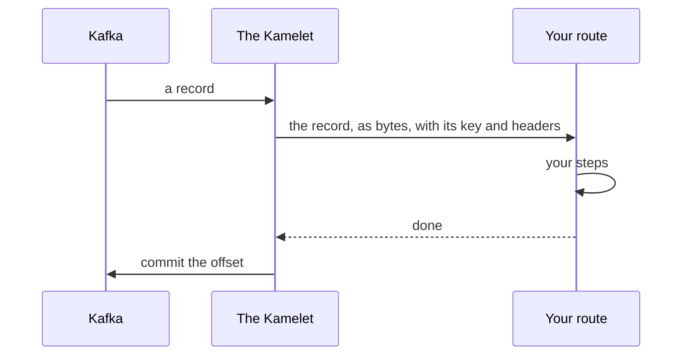

# The Kamelet: a Kafka consumer you configure instead of write

This repository has one reusable piece, the Kamelet
[`kamelets/kafka-at-least-once-source.kamelet.yaml`](../kamelets/kafka-at-least-once-source.kamelet.yaml). With it, **a new Kafka
consumer is a few settings and the route that handles each record**; it never writes the Kafka settings or the offset commit again.

Read this to add another consumer. For the consumer that is already here, see [conv-history-consumer.md](conv-history-consumer.md).

## What a Kamelet is

A **Kamelet** is a route template with a declared interface: a list of parameters, each with a type and a description. A route uses it as
an endpoint, `kamelet:<name>?param=value`, and Camel fills the template in
([Camel's guide](https://camel.apache.org/camel-kamelets/next/development.html), [the component](https://camel.apache.org/components/kamelet-component.html)).
This one is a **source**: it starts a route.

## What this Kamelet does



*In words:* the Kamelet reads one record at a time with auto commit **off**, hands it to your route, and commits the offset **only when your
route has finished with it**. A record your route did not finish is never covered by a later commit: this is at-least-once delivery, so
your steps should tolerate seeing a record twice (the store here does: the inbox refuses a duplicate).

| Your route | What the Kamelet does |
|---|---|
| Finishes normally | Commits the offset |
| Handles the error itself (`onException` with `handled`, for example a dead-letter route) and finishes | Commits the offset |
| Retries forever inside a step (a dependency is down) | Never returns, so the offset does not move; nothing is skipped |
| **Throws and nothing handles it** | **Does not commit and reads the same record again, over and over; every record behind it waits.** Measured: three deliveries of the failed record in seven seconds, offset stuck at it, the next record never delivered |

The last row is the one to remember: **every consumer must decide what a bad record becomes.** This project's `errorRules` and route 3
(a dead-letter log) do that; a consumer without such a rule blocks its partition on the first record it cannot handle.

## Parameters

| Parameter | Required | Default | What it is |
|---|---|---|---|
| `topic` | yes | | The topic to read |
| `brokers` | yes | | Kafka bootstrap servers, `host:port`, comma separated (`kafka:29092` inside the cluster network) |
| `groupId` | yes | | The consumer group. **One group per consumer**: two projects in one group split the partitions between them |
| `autoOffsetReset` | no | `earliest` | Where a group with no committed offset starts: `earliest` (the topic's beginning) or `latest` |

Fixed inside the Kamelet, the same for every consumer: auto commit off, manual commit on, the record body as raw bytes, the key and the Kafka
headers kept (`CamelKafkaPartition`, `CamelKafkaOffset`, `CamelKafkaKey` and the rest), and `breakOnFirstError` on (the re-read of a failed
record above). The Kamelet declares its own dependency (`camel:kafka`), so a project needs no `camel.jbang.dependencies` line for it.

In the Karavan Designer the Kamelet appears as **"Kafka at-least-once source"** with these four fields, so a parameter is edited in a form.

## Create another consumer

A Karavan project is a folder of the repository: one folder, one container. These are the files of a smallest consumer, which logs every
record. It was run on throwaway topics: the records published were logged, their offsets committed, and the group ended with lag 0.

`my-consumer/application.properties`

```properties
camel.main.name=my-consumer
app.topic=my.topic
app.kafka.brokers=kafka:29092
app.kafka.groupId=my-consumer
```

`my-consumer/log-events.camel.yaml`

```yaml
- route:
    id: routeLogEvents
    description: 1 Log events
    from:
      id: fromTopic
      description: Topic (Kamelet source)
      uri: kamelet:kafka-at-least-once-source
      parameters:
        topic: "{{app.topic}}"
        brokers: "{{app.kafka.brokers}}"
        groupId: "{{app.kafka.groupId}}"
      steps:
        - log:
            id: logRecord
            description: 1.1 Log the record
            message: "Got partition=${header.CamelKafkaPartition} offset=${header.CamelKafkaOffset} key=${header.CamelKafkaKey}: ${bodyAs(String)}"
```

`my-consumer/docker-compose.yaml` (Karavan reads it for the container's name and port)

```yaml
services:
  my-consumer:
    container_name: my-consumer
    image: my-consumer
    restart: always
    ports:
      - "8088:8080"
    networks:
      - karavan
```

Then:

1. **Choose the names and the port.** The container name must be unique on the shared network, and the host port free:
   `lsof -nP -iTCP:8088 -sTCP:LISTEN` prints nothing when it is free. Ports in use by the two stacks are in
   [karavan-setup.md](karavan-setup.md#running-next-to-ms-ml-camel-conv-history-bs). In the compose file the port is plain `host:container`
   (Karavan's parser fails on `127.0.0.1:8088:8080`).
2. **A new group** in `app.kafka.groupId`. Never reuse another consumer's group.
3. **Commit and push**, then in Karavan open the folder as a project (**Pull** if it is already on GitHub) and press the top-right **Run**.
   Karavan copies the Kamelet into the container for you: it finds `uri: kamelet:kafka-at-least-once-source` in your routes and takes the
   file from its `kamelets` project, which is the repository's `kamelets/` folder. You copy nothing.
4. **Check it.** The container log shows `Routes startup (total:1 started:1 kamelets:1)` and `Successfully joined group`; publish a record
   and a `Got partition=...` line appears; and the group has no lag:
   `docker exec yape-kafka kafka-consumer-groups --bootstrap-server kafka:29092 --describe --group my-consumer`.

To run it without Karavan first, `./scripts/devmode-local.sh my-consumer APP_TOPIC=<throwaway> APP_KAFKA_GROUPID=<throwaway>` does the same
copy of the Kamelet (it needs `my-consumer/` at the repository root). Karavan Run itself was verified for this repository's consumer
(`ms-ml-conv-history-consumer`), not for a `my-consumer` project.

## A real consumer: add what is yours

The log step is where a consumer's own work goes. This project's consumer replaces it with, in order:

1. **A decoder** (a bean) for its own record format and contract: here `ConversationEventDecoder.java`, step 1.1.
2. **A store route** for its own tables, called with `direct:`: here `store-conversation-history.camel.yaml`.
3. **Error rules and a dead-letter route**: here `handle-errors-and-dead-letters.camel.yaml`. The route references them with
   `routeConfigurationId: errorRules`. A record the consumer can never handle must end as *handled*, so the Kamelet commits and the
   partition moves on.

Copy the project folder `ms-ml-conv-history-consumer/` as the starting point, rename it, change the three `app.*` settings, the container
name and the port, and replace the decoder and the store. Route 1 and the Kamelet stay as they are.

## Changing the Kamelet

It is shared: a change reaches **every consumer** the next time it is run (Karavan copies the file when it starts the container, so a running
container keeps the old one until it is recreated). For a change that would break a consumer, add a new Kamelet under a new name instead
and move consumers to it one by one. After a change, run `./scripts/test-consumer.sh`: it runs this project with the Kamelet and checks
that no record is lost, none is committed early, and an outage leaves the offset where it was.

## What was not verified

- Karavan **Run** was verified for this repository's consumer, not for a second project. The example above was run with the local runner
  (`devmode-local.sh`), which copies the Kamelet the same way.
- Only the default `earliest` start was exercised; `latest` is Kafka's standard option and untested here.
- A route that handles errors but then fails *inside the handler* was not tried.
